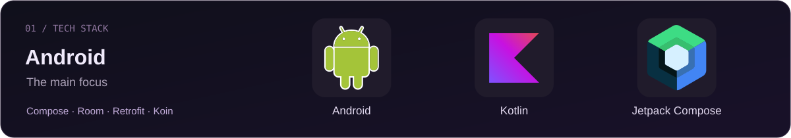
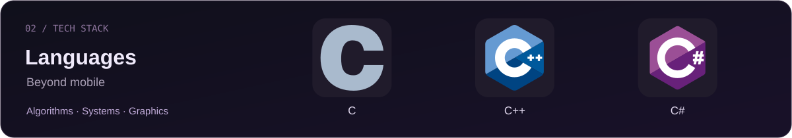
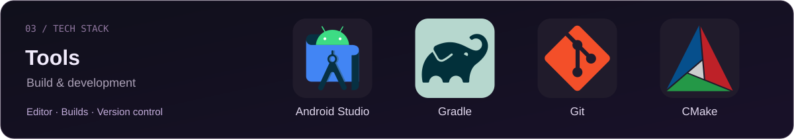
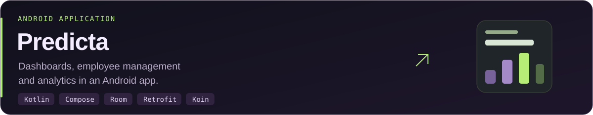
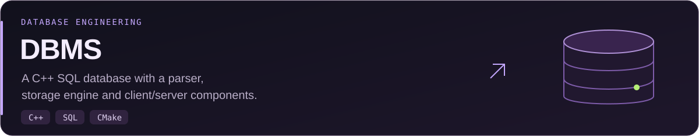
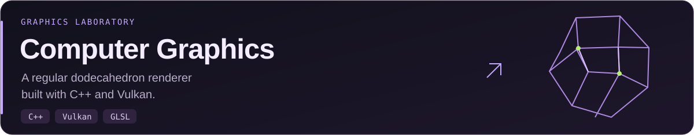

<picture>
  <source media="(max-width: 600px)" srcset="./assets/header-mobile.svg">
  
</picture>

  <a href="#tech-stack">Tech Stack</a> &nbsp; / &nbsp;
  <a href="#featured-projects">Featured Projects</a> &nbsp; / &nbsp;
  <a href="#university-projects">Coursework</a>

I build Android apps with **Kotlin** and **Jetpack Compose**, alongside hands-on work in algorithms, systems programming and computer graphics.

## Tech Stack

<picture>
  <source media="(max-width: 600px)" srcset="./assets/stack-android-mobile.svg">
  
</picture>

<picture>
  <source media="(max-width: 600px)" srcset="./assets/stack-languages-mobile.svg">
  
</picture>

<picture>
  <source media="(max-width: 600px)" srcset="./assets/stack-tools-mobile.svg">
  
</picture>

## Featured Projects

<a href="https://github.com/Heavenfiend/Predicta">
<picture>
  <source media="(max-width: 600px)" srcset="./assets/project-predicta-mobile.svg">
  
</picture>
</a>

<a href="https://github.com/Heavenfiend/DBMS">
<picture>
  <source media="(max-width: 600px)" srcset="./assets/project-dbms-mobile.svg">
  
</picture>
</a>

<a href="https://github.com/Heavenfiend/computer-graphics">
<picture>
  <source media="(max-width: 600px)" srcset="./assets/project-graphics-mobile.svg">
  
</picture>
</a>

<b>More Android practice</b> — Compose &amp; networking

- **[vkhomework2](https://github.com/Heavenfiend/vkhomework2)** — GIF browsing with Compose and Retrofit.
- **[vk_homework1](https://github.com/Heavenfiend/vk_homework1)** — Android / Compose practice.

## University Projects

Coursework organized by subject. Open a collection to explore the repositories.

<b>Cryptography &amp; Graphics</b> — Kotlin · C++ · Vulkan

- **[Cryptography](https://github.com/Heavenfiend/Cryptography)** — Feistel networks, DES and DEAL implemented in Kotlin.
- **[Computer Graphics](https://github.com/Heavenfiend/computer-graphics)** — C++ / Vulkan graphics labs.

<b>Algorithms &amp; Data Structures</b> — C# · C++

- **[FIIT_FA](https://github.com/Heavenfiend/FIIT_FA)** — trees and big integer arithmetic in C#.
- **[FIIT_SP](https://github.com/Heavenfiend/FIIT_SP)** — C++ allocators and associative containers.

<b>Systems Programming</b> — C

[OS_2025](https://github.com/Heavenfiend/OS_2025) &nbsp; / &nbsp; [OS2](https://github.com/Heavenfiend/OS2) &nbsp; / &nbsp; [OS3](https://github.com/Heavenfiend/OS3)

C labs covering processes, pipes and related systems programming exercises.

<b>Object-Oriented Programming</b> — C++

[OOP](https://github.com/Heavenfiend/OOP) &nbsp; / &nbsp; [OOP2](https://github.com/Heavenfiend/OOP2) &nbsp; / &nbsp; [OOP3](https://github.com/Heavenfiend/OOP3) &nbsp; / &nbsp; [OOP4](https://github.com/Heavenfiend/OOP4) &nbsp; / &nbsp; [OOP5](https://github.com/Heavenfiend/OOP5) &nbsp; / &nbsp; [OOP6](https://github.com/Heavenfiend/OOP6) &nbsp; / &nbsp; [OOP7](https://github.com/Heavenfiend/OOP7)

C++ exercises and lab collections.

<!-- Group titles describe repository content, not official course names.
     Add degree-year groups only after the mapping is confirmed. -->

---

  <a href="https://github.com/Heavenfiend?tab=repositories">Explore all public repositories ↗</a>

