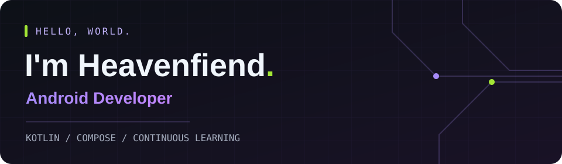

  

  <picture>
    <source media="(prefers-color-scheme: dark)" srcset="https://readme-typing-svg.demolab.com?font=Fira+Code&amp;size=18&amp;duration=2800&amp;pause=1400&amp;color=A3E635&amp;center=true&amp;vCenter=true&amp;width=360&amp;height=45&amp;lines=Building+Android+apps.;Learning+by+building.">
    
  </picture>

  <a href="#about-me">About</a> ·
  <a href="#tech-stack">Tech Stack</a> ·
  <a href="#development">Development</a> ·
  <a href="#university-projects">University</a>

## About Me

Android Developer focused on Kotlin and Jetpack Compose. I build Android apps and explore algorithms, systems programming, and computer graphics through hands-on projects.

## Tech Stack

  

**Android:** Kotlin · Jetpack Compose · Android Studio · Gradle  
**Also working with:** C · C++ · C# · Vulkan

## Development

**[Predicta](https://github.com/Heavenfiend/Predicta)**  
Android app with dashboards, employee management, and analytics.  
`Kotlin` `Jetpack Compose` `Room` `Retrofit` `Koin`

**[DBMS](https://github.com/Heavenfiend/DBMS)**  
A SQL database management system written in C++, with client and server components.

Android practice

- [vkhomework2](https://github.com/Heavenfiend/vkhomework2) — GIF browsing with Compose and Retrofit.
- [vk_homework1](https://github.com/Heavenfiend/vk_homework1) — Android / Compose practice.

## University Projects

Selected labs, grouped by subject.

| Area | Project |
| :--- | :--- |
| Cryptography | [Cryptography](https://github.com/Heavenfiend/Cryptography) — Kotlin, Feistel networks, DES & DEAL |
| Computer graphics | [computer-graphics](https://github.com/Heavenfiend/computer-graphics) — C++ / Vulkan, a dodecahedron renderer |

More coursework &amp; lab collections

- **C++ / OOP:** [OOP](https://github.com/Heavenfiend/OOP) · [OOP2](https://github.com/Heavenfiend/OOP2) · [OOP3](https://github.com/Heavenfiend/OOP3) · [OOP4](https://github.com/Heavenfiend/OOP4) · [OOP5](https://github.com/Heavenfiend/OOP5) · [OOP6](https://github.com/Heavenfiend/OOP6) · [OOP7](https://github.com/Heavenfiend/OOP7)
- **C / systems labs:** [OS_2025](https://github.com/Heavenfiend/OS_2025) · [OS2](https://github.com/Heavenfiend/OS2) · [OS3](https://github.com/Heavenfiend/OS3)
- **C# / algorithms:** [FIIT_FA](https://github.com/Heavenfiend/FIIT_FA) — trees and big integer arithmetic.
- **C++ / lab collection:** [FIIT_SP](https://github.com/Heavenfiend/FIIT_SP) — allocators and associative containers.

<!-- Add year-based groups only after the academic year of each repository is confirmed. -->
